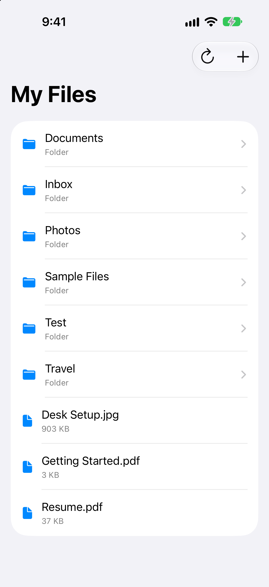

# Filey

Filey is a native iOS file-browser demo built with SwiftUI and Supabase. Browse folders, upload photos and PDFs,
and preview and manage files in one shared workspace.

  

## Features

- Browse root and nested folders
- Load more items as you scroll and refresh from the toolbar
- Create folders with safe retries
- Import and upload PDFs and photos
- Preview files with Quick Look and use its built-in sharing and export actions
- Delete files with confirmation
- Retry failed uploads without creating duplicate files

Filey uses one shared demo workspace. It does not require signup or login; all installations access the same content
using a configured API key. The demo includes real PDFs and photos to explore.

## Built With

- Swift and SwiftUI
- Observation and Swift concurrency
- URLSession for networking and file transfers
- PhotosUI, ImageIO, and Quick Look
- Supabase Postgres, private Storage, and Edge Functions
- Swift Testing and Deno tests

The project targets iOS 27 or later. This repository includes the iOS app and its backend.

## Running the Project

1. Clone the repository.
2. Copy `Configuration/LocalConfiguration.example.plist` to `Filey/LocalConfiguration.plist`.
3. Set `FileyAPIKey` in the copied file to the shared API key configured on the backend.
4. Open `Filey.xcodeproj` in a compatible Xcode version and select the `Filey` scheme.
5. Choose an iPhone Simulator or configure signing for your device, then build and run.

The app connects to the hosted Supabase project by default. You need its configured API key, or you can run your own
backend using the [backend guide](https://github.com/samyanez94/Filey/wiki/Backend) and update
`AppConfiguration.baseURL`. The copied plist is Git-ignored. Keep the shared key private; never use a Supabase
service-role key in the app.

## Documentation

- [App Overview](https://github.com/samyanez94/Filey/wiki/App-Overview) — features, sample files, and current limits.
- [Architecture](https://github.com/samyanez94/Filey/wiki/Architecture) — screen state, networking, and file handling.
- [Development](https://github.com/samyanez94/Filey/wiki/Development) — run, test, and format the iOS app.
- [Backend](https://github.com/samyanez94/Filey/wiki/Backend) — Supabase setup, API, cleanup, and deployment.
